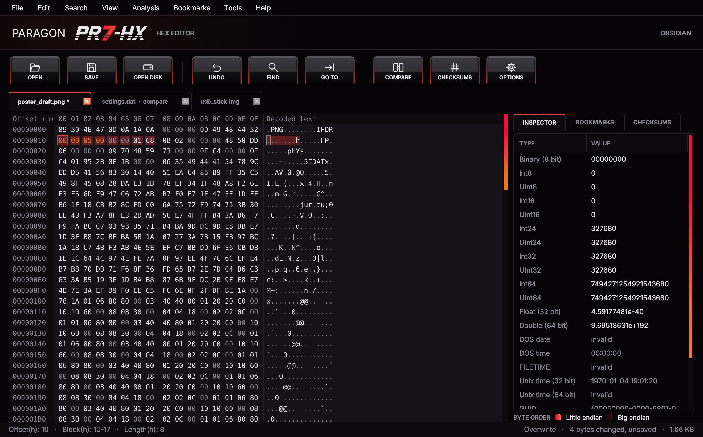
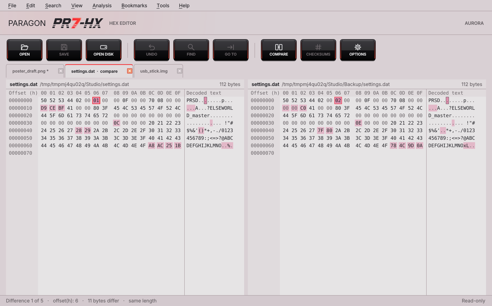
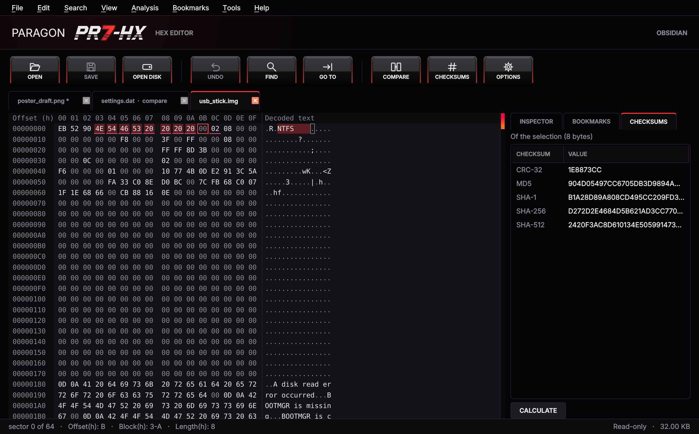

# Paragon PR7-HX

A hex editor that works the way **HxD** works, in the Paragon family look (PR7-Z, PR7-W, PR7-L, PR7-F, PR7-E, PR7-R,
PR7-P, PR7-M, PR7-Q, PR7-U, PR7-DU, PR7-CB, PR7-IS, PR7-PM, PR7-SM, PR7-HB, PR7-FS, PR7-AR, PR7-WM). Python and PySide6.

## What it does

- **Any file, any size:** files open at once, however big. They stay on disk, and only what's on screen is read.
- **Edit like HxD:**
  - type hex digits or characters, in Insert or Overwrite mode (Insert key);
  - Backspace and Delete;
  - Cut / Copy / Paste Insert (Ctrl+V) / Paste Write (Ctrl+B);
  - Copy As hex, C array, Python bytes or Base64;
  - Select Block, Fill Selection;
  - Undo / Redo for everything.
  
  Changed bytes are orange until you save. Saving goes through a temporary file, so a failed save never leaves half a
  file.
- **Data inspector:** the bytes at the cursor as binary, 8/16/24/32/64-bit integers, float, double, DOS date and time,
  FILETIME, Unix time, GUID and characters, little or big endian. Double-click a value to type a new one.
- **Find and Replace:** hex values, text (ANSI, UTF-8, UTF-16, with or without case), integers and floating point
  numbers. Find All, Find Next / Previous (F3 / Shift+F3), Replace All. **Go To** an offset (hex or decimal, from the
  start, the cursor or the end).
- **Bookmarks** (Ctrl+D) and **Checksums:** CRC-32, MD5, SHA-1, SHA-256 and SHA-512 of the selection or the whole file.
- **File compare** (Ctrl+K): two files side by side, the differing bytes marked, Next / Previous difference (F6 / Shift+F6).
- **Disks:** Open Disk lists Windows' drives and physical disks; Open Disk Image opens image files.
  - Disks open **read-only**. Writing has to be turned on (Edit > Read-only), and Save asks again before writing.
  - Only the changed sectors are written, and a disk can't grow or shrink.
  - Reading a disk needs administrator rights.
- **Explorer menu:** "Edit with PR7-HX" on every file.

## Building

`pip install -r requirements.txt -r requirements-dev.txt`, `python -m pytest`, `pyinstaller pr7hx.spec`, then Inno Setup:
`iscc /DAppVersion=x.y.z installer\pr7hx.iss`.
